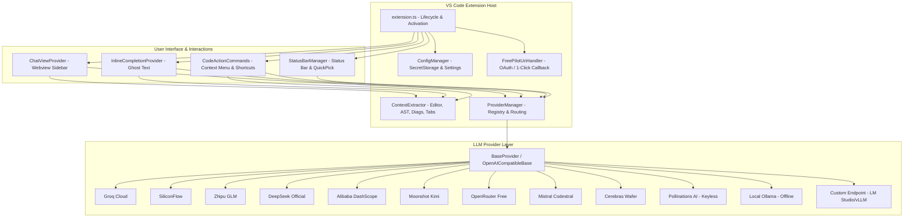
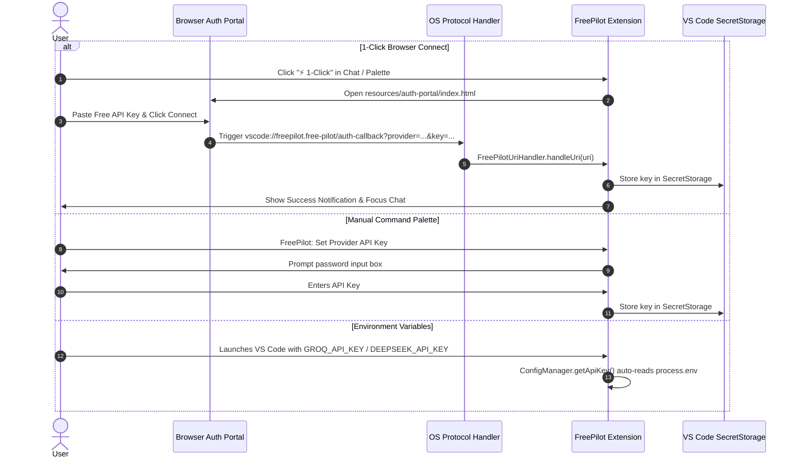

# ⚡ FreePilot — Complete User & Technical Manual

> **Version**: 0.1.0  
> **Platform**: Visual Studio Code (v1.85.0+)  
> **Repository**: [https://github.com/kishanmaxx/free-pilot.git](https://github.com/kishanmaxx/free-pilot.git)  
> **License**: MIT  

---

## 📑 Table of Contents
1. [Introduction & Overview](#1-introduction--overview)
2. [System Architecture](#2-system-architecture)
3. [Installation & Getting Started](#3-installation--getting-started)
4. [Authentication & Credential Management](#4-authentication--credential-management)
5. [The 12 AI Providers & Model Catalog](#5-the-12-ai-providers--model-catalog)
6. [Core Features & Usage Workflows](#6-core-features--usage-workflows)
   - [6.1 Interactive Sidebar AI Chat Assistant](#61-interactive-sidebar-ai-chat-assistant)
   - [6.2 Real-Time Inline Ghost-Text Code Completions (FIM)](#62-real-time-inline-ghost-text-code-completions-fim)
   - [6.3 One-Click Context Menu Code Actions](#63-one-click-context-menu-code-actions)
   - [6.4 Status Bar Widget & Quick Model Switcher](#64-status-bar-widget--quick-model-switcher)
7. [Full Configuration Reference](#7-full-configuration-reference)
8. [Keyboard Shortcuts Cheat Sheet](#8-keyboard-shortcuts-cheat-sheet)
9. [Network Resilience, Rate Limiting & Auto-Failover](#9-network-resilience-rate-limiting--auto-failover)
10. [Troubleshooting & Frequently Asked Questions](#10-troubleshooting--frequently-asked-questions)
11. [Developer Guide: Extending FreePilot](#11-developer-guide-extending-freepilot)

---

## 1. Introduction & Overview

**FreePilot** is an open-source, zero-subscription AI coding companion designed for Visual Studio Code. It bridges the gap between commercial proprietary assistants (such as GitHub Copilot and Cursor AI) and generous global free-tier models and local offline LLMs.

### Key Highlights
- **100% Free**: Operates using permanent free tiers, free API credits, keyless cloud endpoints, and offline local inference.
- **Privacy & Security First**: API keys are encrypted inside the operating system's native keychain via VS Code `SecretStorage`. Local Ollama operates with zero telemetry and zero network egress.
- **Multi-Provider Agility**: Connects to 12 distinct AI engines across China, the United States, Europe, and local machines.
- **Deep Editor Integration**: Full support for real-time ghost text (Fill-in-the-Middle), side-by-side diff previews, active compiler diagnostic awareness, and multi-file cross-tab context extraction.

---

## 2. System Architecture

FreePilot is built with a modular, decoupled architecture where each subsystem operates independently through well-defined interfaces and singleton managers.

### 2.1 High-Level Component Flow



### 2.2 Subsystem Breakdown

| Subsystem | Location | Primary Responsibility |
| :--- | :--- | :--- |
| **Lifecycle Coordinator** | `src/extension.ts` | Activates services, hooks configuration listeners, binds URI handlers, and registers commands. |
| **Configuration Manager** | `src/config.ts` | Handles typed configuration queries, config updates, and secure storage in `vscode.SecretStorage`. |
| **Provider Manager** | `src/providers/providerManager.ts` | Provider registry, model metadata catalogs, active instance routing, and auto-failover selection. |
| **Context Extractor** | `src/utils/contextExtractor.ts` | Extracts cursor position, selection, active file diagnostics, and symbols from neighboring open tabs. |
| **Chat View Provider** | `src/chat/chatViewProvider.ts` | Webview lifecycle, message passing, token-aware sliding window memory, and cross-session persistence. |
| **Inline Completion Provider** | `src/completion/inlineCompletionProvider.ts` | FIM completion engine, debounce timer, multi-line formatting, and LRU cache. |
| **Code Actions** | `src/commands/codeActions.ts` | Implements right-click editor commands (Explain, Fix, Refactor, Tests, Docs, Audit). |
| **Status Bar Manager** | `src/ui/statusBar.ts` | Dynamic status bar item with active model details, health tooltip, and interactive picker. |
| **Auth & URI Handler** | `src/auth/` | Deep-link callback protocol (`vscode://freepilot.free-pilot/auth-callback`) and 1-Click web portal. |
| **Network Utilities** | `src/utils/networkUtils.ts` | Resilient fetch client with exponential backoff, rate-limit header parsing, and network drop recovery. |

---

## 3. Installation & Getting Started

### 3.1 Prerequisites
- **Node.js**: v18.0.0 or higher
- **VS Code**: Version 1.85.0 or later
- **npm**: v9.0.0 or later

### 3.2 Method 1: Running in Development Mode (F5)
Ideal for testing changes or modifying the extension:
1. Clone the repository and navigate to the project root:
   ```bash
   git clone https://github.com/kishanmaxx/free-pilot.git
   cd free-pilot
   ```
2. Install dependencies:
   ```bash
   npm install
   ```
3. Open the project in VS Code:
   ```bash
   code .
   ```
4. Press **`F5`** (or go to **Run & Debug** > **Run FreePilot Extension**).
5. A new **Extension Development Host** window will launch with FreePilot pre-loaded.
6. Press `Ctrl+Alt+C` (macOS: `Cmd+Alt+C`) or click the **FreePilot AI** icon in the activity bar.

### 3.3 Method 2: Package into `.vsix` for Daily Use
To install FreePilot as a permanent extension inside your primary VS Code editor:
1. Compile and package the extension:
   ```bash
   npm run package
   ```
   *This executes `node esbuild.js --production` and generates `free-pilot-0.1.0.vsix` in the workspace root.*
2. Install into VS Code:
   - **Via CLI**:
     ```bash
     code --install-extension free-pilot-0.1.0.vsix
     ```
   - **Via VS Code UI**:
     - Open the Extensions View (`Ctrl+Shift+X` / `Cmd+Shift+X`).
     - Click the **`...`** (Views and More Actions) menu in the top-right corner.
     - Select **Install from VSIX...**.
     - Choose `free-pilot-0.1.0.vsix`.

---

## 4. Authentication & Credential Management

FreePilot provides multiple flexible, secure options for authenticating with various AI providers.



### 4.1 1-Click Browser Connect / OAuth Portal
FreePilot includes a built-in auth gateway (`resources/auth-portal/index.html`) that allows users to authenticate in a single click:
1. Click **`⚡ 1-Click`** on the chat header or execute command `FreePilot: 1-Click Browser Connect / OAuth`.
2. Select your provider. FreePilot opens the provider's token console.
3. Paste the key into the portal and click **🚀 Connect to VS Code in 1-Click**.
4. The browser invokes the custom URI scheme:
   ```text
   vscode://freepilot.free-pilot/auth-callback?provider=<provider_id>&key=<api_key>&model=<optional_model>
   ```
5. `FreePilotUriHandler` receives the token, persists it into `vscode.SecretStorage`, updates the active provider, and opens the chat assistant.

### 4.2 Manual Command Palette Setup
1. Press `Ctrl+Shift+P` (macOS: `Cmd+Shift+P`).
2. Search and select: `FreePilot: Set Provider API Key`.
3. Choose the target provider.
4. Input your API key. Inputs are masked for privacy.
5. To clear a key, simply leave the input blank and hit `Enter`.

### 4.3 Environment Variable Fallback
If you work in CI/CD, containers, or prefer configuring your shell profile (`~/.bashrc`, `~/.zshrc`, Windows System Environment Variables), FreePilot automatically detects the following environment variables:

| Provider | Environment Variable |
| :--- | :--- |
| **Groq Cloud** | `GROQ_API_KEY` |
| **SiliconFlow** | `SILICONFLOW_API_KEY` |
| **Zhipu AI** | `ZHIPU_API_KEY` |
| **DeepSeek** | `DEEPSEEK_API_KEY` |
| **Alibaba DashScope** | `DASHSCOPE_API_KEY` |
| **Moonshot Kimi** | `MOONSHOT_API_KEY` or `KIMI_API_KEY` |
| **OpenRouter** | `OPENROUTER_API_KEY` |
| **Mistral AI** | `MISTRAL_API_KEY` |
| **Cerebras Cloud** | `CEREBRAS_API_KEY` |
| **Custom Endpoint** | `CUSTOM_API_KEY` |

---

## 5. The 12 AI Providers & Model Catalog

FreePilot integrates with 12 distinct cloud and local inference providers:

| Provider | Region | Default Model | Requires Key? | FIM Support? | Highlights & Free Tier Details | Free Key Console |
| :--- | :---: | :--- | :---: | :---: | :--- | :--- |
| **SiliconFlow<br>(硅基流动)** | 🇨🇳 China | `deepseek-ai/DeepSeek-V3` | Yes | ✅ Yes | DeepSeek V3, DeepSeek R1, Qwen 2.5 Coder 32B, GLM-4 9B. Generous free starter balance and permanent free models. | [SiliconCloud](https://cloud.siliconflow.cn/account/ak) |
| **Zhipu AI<br>(智谱清言)** | 🇨🇳 China | `glm-4-flash` | Yes | ❌ Chat | `glm-4-flash` is **100% Free Forever** with unlimited API calls and 128k context window. | [Zhipu BigModel](https://open.bigmodel.cn/usercenter/apikeys) |
| **DeepSeek Official** | 🇨🇳 China | `deepseek-chat` | Yes | ✅ Yes | Direct official API access to `deepseek-chat` (V3) and `deepseek-reasoner` (R1). Includes free starter credits. | [DeepSeek Platform](https://platform.deepseek.com/api_keys) |
| **Alibaba DashScope<br>(通义千问)** | 🇨🇳 China | `qwen2.5-coder-32b-instruct` | Yes | ✅ Yes | Qwen 2.5 Coder 32B, Qwen Plus, Qwen Turbo. Free token tier on Alibaba Cloud DashScope. | [DashScope Console](https://dashscope.console.aliyun.com/apiKey) |
| **Moonshot Kimi<br>(月之暗面)** | 🇨🇳 China | `moonshot-v1-8k` | Yes | ❌ Chat | `moonshot-v1-8k`, `32k`, `128k`, `auto`. Free starter quota with ultra-long context reasoning. | [Moonshot Platform](https://platform.moonshot.cn/console/api-keys) |
| **Groq Cloud** | 🇺🇸 USA | `llama-3.3-70b-versatile` | Yes | ❌ Chat | Llama 3.3 70B, DeepSeek R1 Distill 70B, Llama 3.1 8B, Mixtral 8x7B. Ultra-fast inference on LPU chips (500+ tok/s). | [Groq Console](https://console.groq.com/keys) |
| **Cerebras Cloud** | 🇺🇸 USA | `llama3.3-70b` | Yes | ❌ Chat | Llama 3.3 70B, Llama 3.1 8B. World's fastest inference on Wafer-Scale Engine (1800+ to 2100+ tok/s). | [Cerebras Cloud](https://cloud.cerebras.ai/) |
| **Pollinations AI** | 🌸 Global | `openai-fast` | **No** | ✅ Yes | **100% Free & Unlimited** in the cloud. Zero authentication or API key required. Models: `openai-fast`, `openai`, `mistral`, `gpt-4o`. | [Pollinations.ai](https://pollinations.ai/) |
| **OpenRouter** | 🌐 Global | `deepseek/deepseek-r1:free` | Yes | ✅ Yes | Access to all `:free` tag models (DeepSeek R1, DeepSeek V4 Flash, Qwen 3.8 27B, Nemotron 3.5, GLM 5.2, Gemma 4). | [OpenRouter Keys](https://openrouter.ai/keys) |
| **Mistral AI** | 🇫🇷 France | `codestral-latest` | Yes | ✅ Yes | `codestral-latest` (specialized in 80+ programming languages) and `mistral-small-latest`. Free developer tier. | [Mistral Console](https://console.mistral.ai/api-keys/) |
| **Local Ollama** | 💻 Offline | `qwen2.5-coder` | **No** | ✅ Yes | **100% Free, Private & Offline**. Runs locally on `http://localhost:11434`. Works with `qwen2.5-coder`, `deepseek-coder-v2`, `codellama`, `llama3.2`. | [Ollama.ai](https://ollama.ai/) |
| **Custom Endpoint** | 🛠️ Custom | `local-model` | Optional | ❌ Chat | Connects to any OpenAI-compatible server (LM Studio, LocalAI, vLLM, FastChat, text-generation-webui). | Configurable URL |

---

## 6. Core Features & Usage Workflows

### 6.1 Interactive Sidebar AI Chat Assistant

The sidebar chat view is the primary interactive hub of FreePilot.

#### How to Open
- Click the **FreePilot AI** icon on the VS Code Activity Bar.
- Shortcut: **`Ctrl + Alt + C`** (macOS: **`Cmd + Alt + C`**).
- Command: `FreePilot: Open Chat Assistant`.

#### Chat Capabilities
1. **Real-Time Token Streaming**: Responses are rendered incrementally in real time.
2. **DeepSeek R1 `<think>` Block Handling**: When interacting with reasoning models (DeepSeek R1, DeepSeek R1 Distill, etc.), chain-of-thought tokens inside `<think>` tags are rendered in a sleek collapsible container:
   - While streaming: Appears open as `💭 Thinking...`.
   - When finished: Collapses into `💭 Thought Process` so answers remain clean.
3. **Interactive Code Block Actions**:
   Every generated code snippet features 4 immediate actions:
   - 📋 **Copy**: Copies snippet to clipboard.
   - 📥 **Insert**: Injects snippet directly at current cursor position in your active editor.
   - 🔄 **Replace**: Replaces highlighted selection in active editor with the code block.
   - ⚡ **Diff**: Opens a side-by-side VS Code Diff Editor (`active_file ↔ FreePilot Suggestion`) to inspect modifications before applying them.
4. **Context Chips**:
   The context bar above the input box dynamically displays the active file name and selected line count.
5. **Cross-Session Persistence**:
   Chat history is automatically saved to VS Code `globalState`. Closing VS Code or switching workspaces preserves your chat history.
6. **Token-Aware Sliding Window**:
   Chat history dynamically trims older turns once estimated conversation tokens exceed 14,000, preventing token overflow errors while retaining recent context.

---

### 6.2 Real-Time Inline Ghost-Text Code Completions (FIM)

FreePilot acts like GitHub Copilot by analyzing code around your cursor and suggesting inline ghost text as you type.

#### How It Works
1. **Cursor Context Capture**: Extracts up to 4,000 characters preceding the cursor (`prefix`) and 1,500 characters following the cursor (`suffix`).
2. **Neighboring Tabs Reference Extraction**: Automatically inspects other open editor tabs and extracts exported types, interfaces, and function signatures. This enables completions to know about types defined in other files without a language server.
3. **Fill-In-The-Middle (FIM)**: Prompts models supporting FIM using their native tokens:
   - **DeepSeek / Qwen**: `<｜fim begin｜>{prefix}<｜fim hole｜>{suffix}<｜fim end｜>`
   - **CodeLlama**: `<PRE> {prefix} <SUF>{suffix} <MID>`
   - **StarCoder**: `<fim_prefix>{prefix}<fim_suffix>{suffix}<fim_middle>`
4. **Debouncing**: Waits 350ms (configurable via `freepilot.inlineCompletionDelayMs`) of inactivity before firing requests, ensuring smooth typing without UI stutter.
5. **Caching**: Features an in-memory LRU cache (capacity: 50 items, TTL: 60s) to return instant completions when navigating back and forth.
6. **Filtering**: Automatically suppresses completions on Markdown, JSON, YAML, plaintext, Git commit messages, diffs, or files exceeding 10,000 lines.

#### Accepting & Dismissing Completions
- **Accept Full Suggestion**: Press **`Tab`**.
- **Dismiss Suggestion**: Press **`Esc`** or continue typing.
- **Toggle On/Off**: Execute command `FreePilot: Toggle Inline Completions (Ghost Text)`.

---

### 6.3 One-Click Context Menu Code Actions

Highlight any section of code in the editor, right-click to open the context menu, and expand the **FreePilot** submenu (or use keyboard shortcuts):

```
┌─────────────────────────────────────────────────────────────┐
│ ⚡ FreePilot: Explain Selected Code        (Ctrl+Alt+E)    │
│ 🛠️ FreePilot: Fix Bugs & Errors in Selection (Ctrl+Alt+F)    │
│ 🔄 FreePilot: Refactor & Optimize Code                     │
│ 🧪 FreePilot: Generate Unit Tests                           │
│ 📝 FreePilot: Add Documentation & Comments                  │
│ 🔒 FreePilot: Security & Vulnerability Audit                │
│ ✨ FreePilot: Complete Code at Cursor     (Ctrl+Alt+Space)  │
└─────────────────────────────────────────────────────────────┘
```

#### Detailed Action Descriptions
- **Explain Code (`Ctrl+Alt+E`)**: Generates a structured breakdown containing the high-level objective, step-by-step logic flow, edge cases, and parameter explanations.
- **Fix Bugs & Errors (`Ctrl+Alt+F`)**: FreePilot inspects active VS Code compiler warnings and errors (`vscode.languages.getDiagnostics`) overlapping the selected lines, correlates them with the source code, and outputs a diagnostic diagnosis + corrected code block.
- **Refactor & Optimize**: Analyzes readability, cyclomatic complexity, algorithmic time/space complexity, and modern language idioms.
- **Generate Unit Tests**: Produces idiomatic unit tests matching your language standard (e.g. Jest/Vitest for TS/JS, PyTest for Python, JUnit for Java, testing package for Go), covering happy paths and edge cases.
- **Add Documentation & Comments**: Annotates functions with standard docstrings (JSDoc, TSDoc, Python docstrings, GoDoc, JavaDoc).
- **Security & Vulnerability Audit**: Scans code for injection vulnerabilities (SQLi, XSS, command injection), hardcoded credentials, insecure regexes, and memory leaks.
- **Complete Code at Cursor (`Ctrl+Alt+Space`)**: Manually triggers completion at the cursor inside a progress notification modal.

---

### 6.4 Status Bar Widget & Quick Model Switcher

Located on the right side of the VS Code Status Bar:

```text
$(hubot) FreePilot: 🇨🇳 deepseek-ai/DeepSeek-V3
```

#### Features:
1. **Interactive Tooltip**: Hovering over the status bar reveals:
   - Active Provider and country flag.
   - Active Chat Model.
   - Dedicated Inline Completion Model (if configured).
   - API Key configuration state (`✓ Key configured`, `⚠️ Key missing`, or `⚡ Free & Keyless`).
   - Inline Completions active state (`✨ Active` or `⚪ Disabled`).
   - Auto-Failover status (`🛡️ Enabled` or `Disabled`).
2. **Model Switcher**: Click the status bar widget (or run `freepilot.switchModel`) to open the interactive QuickPick catalog of all models across all 12 providers.
3. **Smart Default Fallback**: Switching providers automatically switches the active model to the provider's recommended default model if the previous model is not supported.

---

## 7. Full Configuration Reference

All settings can be customized in VS Code Settings (`Ctrl+,` / `Cmd+,` > search `FreePilot`) or by directly editing `.vscode/settings.json`:

| Setting Key | Type | Default | Valid Values / Range | Description |
| :--- | :---: | :---: | :---: | :--- |
| `freepilot.provider` | `enum` | `"groq"` | `groq`, `siliconflow`, `zhipu`, `deepseek`, `dashscope`, `kimi`, `openrouter`, `mistral`, `cerebras`, `pollinations`, `ollama`, `custom` | The primary AI backend used for chat and general code tasks. |
| `freepilot.model` | `string` | `"llama-3.3-70b-versatile"` | Any model ID supported by the active provider | Active model identifier. |
| `freepilot.completionProvider` | `string` | `""` | Any provider ID or empty | Optional provider override dedicated solely to inline completions (e.g., use `groq` or `siliconflow` for inline while using `deepseek` for chat). |
| `freepilot.completionModel` | `string` | `""` | Any model ID or empty | Optional model override dedicated to inline completions (e.g. `deepseek-ai/DeepSeek-V3`). |
| `freepilot.enableInlineCompletions` | `boolean` | `true` | `true`, `false` | Enable or disable ghost-text completions in the editor. |
| `freepilot.inlineCompletionDelayMs` | `integer` | `350` | `100` – `2000` | Keystroke debounce delay (in milliseconds) before requesting ghost text. |
| `freepilot.completionTimeoutMs` | `integer` | `8000` | `2000` – `30000` | Network timeout for inline code completion requests. |
| `freepilot.chatTimeoutMs` | `integer` | `50000` | `10000` – `120000` | Network timeout for chat assistant requests. |
| `freepilot.maxCompletionTokens` | `integer` | `128` | `16` – `1024` | Maximum tokens to generate for inline code completion. |
| `freepilot.maxChatTokens` | `integer` | `4096` | `512` – `16384` | Maximum tokens to generate for chat responses. |
| `freepilot.temperature` | `number` | `0.2` | `0.0` – `1.0` | Sampling temperature (lower = more deterministic for code). |
| `freepilot.autoFailover` | `boolean` | `true` | `true`, `false` | Automatically failover to a backup free provider if the primary provider encounters an outage or rate limit. |
| `freepilot.streamChatResponses` | `boolean` | `true` | `true`, `false` | Stream chat assistant responses token-by-token. |
| `freepilot.ollamaEndpoint` | `string` | `"http://localhost:11434"` | Valid URL | Endpoint URL for the local Ollama daemon. |
| `freepilot.customEndpoint` | `string` | `"http://localhost:1234/v1"` | Valid URL | Base URL for custom OpenAI-compatible endpoints (LM Studio, vLLM, FastChat). |

### Example `.vscode/settings.json`
```json
{
  "freepilot.provider": "siliconflow",
  "freepilot.model": "deepseek-ai/DeepSeek-V3",
  "freepilot.completionProvider": "groq",
  "freepilot.completionModel": "llama-3.1-8b-instant",
  "freepilot.enableInlineCompletions": true,
  "freepilot.inlineCompletionDelayMs": 300,
  "freepilot.temperature": 0.2,
  "freepilot.autoFailover": true
}
```

---

## 8. Keyboard Shortcuts Cheat Sheet

| Command | Action | Windows / Linux | macOS |
| :--- | :--- | :---: | :---: |
| `freepilot.openChat` | Focus Sidebar Chat Assistant | `Ctrl + Alt + C` | `Cmd + Alt + C` |
| `freepilot.completeCode` | Complete Code at Cursor | `Ctrl + Alt + Space` | `Cmd + Alt + Space` |
| `freepilot.explainCode` | Explain Selected Code | `Ctrl + Alt + E` | `Cmd + Alt + E` |
| `freepilot.fixCode` | Fix Bugs in Selection + Diagnostics | `Ctrl + Alt + F` | `Cmd + Alt + F` |
| `editor.action.inlineSuggest.commit` | Accept Inline Ghost Suggestion | `Tab` | `Tab` |
| `editor.action.inlineSuggest.hide` | Dismiss Inline Ghost Suggestion | `Esc` | `Esc` |

*To customize any shortcut, open VS Code Keyboard Shortcuts (`Ctrl+K Ctrl+S` / `Cmd+K Cmd+S`) and search for `freepilot`.*

---

## 9. Network Resilience, Rate Limiting & Auto-Failover

Free-tier AI APIs frequently implement rate limits (requests per minute / tokens per minute). FreePilot includes dedicated mechanisms to handle these gracefully:

### 9.1 Exponential Backoff & Retry
The `NetworkUtils.fetchWithRetryAndTimeout` engine automatically intercepts:
- HTTP `429 Too Many Requests`
- HTTP `503 Service Unavailable`
- HTTP `504 Gateway Timeout`
- Intermittent socket hang-ups / DNS drops

When a `429` status is received, FreePilot checks the response's `Retry-After` header. If present and under 15 seconds, it waits the specified duration before retrying. Otherwise, it executes an exponential backoff with jitter (`attempt * 1500ms + random`).

### 9.2 Auto-Failover Engine
When `freepilot.autoFailover` is enabled:
If a primary provider hits hard rate limits or is offline, FreePilot selects an available fallback from its fallback candidate sequence:
```text
Pollinations AI (No key needed) ➔ OpenRouter Free ➔ Groq Cloud ➔ SiliconFlow
```

### 9.3 Local Ollama Health Probing
FreePilot provides a lightweight probe (`NetworkUtils.isLocalOllamaRunning`) that checks `http://localhost:11434/api/tags` with a 1.5-second timeout, providing instant feedback in connection tests without hanging the IDE.

---

## 10. Troubleshooting & Frequently Asked Questions

### Q1: The chat responds with "API key is missing for [Provider]"
**Solution**:
1. Click the **🔑** icon on the top right of the FreePilot sidebar chat or press `Ctrl+Shift+P` > `FreePilot: Set Provider API Key`.
2. Enter your key, or use **Pollinations AI** or **Local Ollama**, which require zero API keys.

### Q2: Inline ghost text completions are not appearing
**Checks**:
1. Verify inline completions are enabled: Check the status bar tooltip or ensure `"freepilot.enableInlineCompletions": true`.
2. Check the file type: Non-code files (Markdown, Plaintext, JSON, YAML) are intentionally ignored.
3. Check file size: Files with more than 10,000 lines are skipped for editor performance.
4. Ensure the active provider's API key is valid. If the provider returns 401/429, inline completions fail silently to avoid interrupting your typing.

### Q3: How do I run FreePilot 100% offline without the internet?
**Steps**:
1. Download and install [Ollama](https://ollama.ai/).
2. Pull a code model in your terminal:
   ```bash
   ollama run qwen2.5-coder
   ```
3. In FreePilot, click the status bar or run `FreePilot: Switch AI Provider & Model`.
4. Select `💻 Local Ollama` > `Qwen 2.5 Coder (Local Ollama)`.
5. FreePilot now communicates directly with `http://localhost:11434` with zero external requests.

### Q4: DeepSeek R1 returns extensive `<think>` tags that clutter the chat
**Solution**: FreePilot automatically parses `<think>` tags and renders them inside a collapsed `<details>` summary labeled `💭 Thought Process`. Click the arrow to expand or review the model's inner monologue whenever desired.

### Q5: I get `Rate limit reached (429)` on Groq or SiliconFlow
**Solution**:
- Click the status bar and switch to another provider such as **Pollinations AI**, **Zhipu GLM-4-Flash** (unlimited free), or **OpenRouter Free**.
- Or wait 60 seconds for your free tier RPM window to refresh.

---

## 11. Developer Guide: Extending FreePilot

### 11.1 Project Structure
```text
free-pilot/
├── esbuild.js                     # Fast ESBuild bundler configuration
├── package.json                   # Extension manifest, commands, settings, menus
├── tsconfig.json                  # TypeScript compiler options
├── resources/
│   ├── icon.svg                   # Extension branding icon
│   └── auth-portal/
│       └── index.html             # 1-Click web authentication portal
└── src/
    ├── extension.ts               # Extension entry point (activate/deactivate)
    ├── config.ts                  # Configuration & SecretStorage manager
    ├── types.ts                   # Core interfaces & type declarations
    ├── auth/
    │   ├── authService.ts         # OAuth launcher & callback URI generation
    │   └── uriHandler.ts          # VS Code UriHandler for deep link callbacks
    ├── chat/
    │   └── chatViewProvider.ts    # WebviewViewProvider for sidebar chat
    ├── commands/
    │   └── codeActions.ts         # Editor context menu & quick code actions
    ├── completion/
    │   └── inlineCompletionProvider.ts # FIM ghost-text completion engine
    ├── providers/
    │   ├── baseProvider.ts        # Abstract provider base class
    │   ├── openAICompatibleBase.ts# Base class for OpenAI-compatible REST APIs
    │   ├── providerManager.ts     # Provider registry, fallback & metadata
    │   ├── groqProvider.ts
    │   ├── siliconFlowProvider.ts
    │   ├── zhipuProvider.ts
    │   ├── deepseekProvider.ts
    │   ├── dashscopeProvider.ts
    │   ├── kimiProvider.ts
    │   ├── openRouterProvider.ts
    │   ├── mistralProvider.ts
    │   ├── cerebrasProvider.ts
    │   ├── pollinationsProvider.ts
    │   ├── ollamaProvider.ts
    │   └── customOpenAIProvider.ts
    ├── ui/
    │   ├── statusBar.ts           # Status bar item & model quick-pick
    │   └── webview/
    │       ├── index.html         # Sidebar chat DOM structure
    │       ├── main.css           # Glassmorphic VS Code theme styling
    │       └── main.js            # Frontend event loop & markdown renderer
    └── utils/
        ├── contextExtractor.ts    # Cursor, AST, tab & diagnostic extractor
        ├── networkUtils.ts        # Retry fetch client & network utilities
        └── promptTemplates.ts     # Prompt engineering templates (Chat, FIM, Fix)
```

### 11.2 Adding a New LLM Provider in 3 Steps

If you want to add another OpenAI-compatible AI provider (e.g. Together AI, Fireworks AI, Lepton):

#### Step 1: Create the Provider Class
Create `src/providers/myNewProvider.ts`:
```typescript
import { OpenAICompatibleProvider } from './openAICompatibleBase';

export class MyNewProvider extends OpenAICompatibleProvider {
  constructor() {
    super({
      id: 'mynewprovider' as any,
      name: 'My New AI Cloud',
      baseUrl: 'https://api.mynewprovider.com/v1',
      defaultModel: 'my-model-name',
      supportsFim: true,
      modelFamily: 'chat'
    });
  }
}
```

#### Step 2: Register in `src/types.ts`
Add `'mynewprovider'` to the `ProviderId` union type:
```typescript
export type ProviderId =
  | 'groq'
  | 'siliconflow'
  // ...
  | 'mynewprovider';
```

#### Step 3: Register in `src/providers/providerManager.ts`
1. Import `MyNewProvider`.
2. Add metadata to `this.metadata`:
   ```typescript
   mynewprovider: {
     id: 'mynewprovider',
     name: 'My New Provider',
     flag: '🚀',
     tagline: 'Fast cloud inference',
     apiKeyHelpUrl: 'https://mynewprovider.com/api-keys',
     requiresApiKey: true,
     defaultModel: 'my-model-name',
     models: [ ... ]
   }
   ```
3. Instantiate in `registerProviders()`:
   ```typescript
   this.providers.set('mynewprovider', new MyNewProvider());
   ```

### 11.3 Build and Verification Commands
- **Compile TypeScript**: `npm run compile`
- **Watch Mode**: `npm run watch`
- **Bundle Production JS**: `npm run bundle`
- **Package VSIX**: `npm run package`
